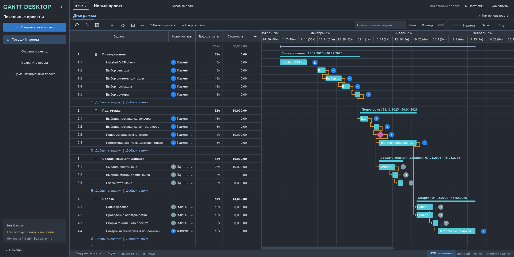

# Gantt Desktop

A local desktop task planner and Gantt editor built with **Python, PySide6 and Qt Quick**. Plan tasks, connect dependencies, manage project resources and inspect workload without an account.

This is an independent application, not a wrapper around the legacy GanttProject engine. Its visual reference is a synthetic GanttPRO project; no GanttPRO source code, branding or downloaded assets are included.

**Version:** 0.19.0 · **Python:** 3.11+ · **Verified platform:** Linux



> [!WARNING]
> This is an experimental application. The [0.19 audit](docs/AUDIT.md) found **five unresolved save/load and editing defects**, including failed date edits that can escape rollback/revision tracking. Keep independent backups and use **read-only MCP for important projects** until these issues are fixed. The existing 1,088 passing tests do not cover every failure path.

## Features

- **Interactive Gantt chart:** tasks, nested groups, milestones, row reordering, bar movement/resizing, progress editing and dependency arrows.
- **Scheduling:** FS, SS, FF and SF dependencies, signed working-time lag, cycle detection and downstream date propagation.
- **Task details:** notes, status, priority, colors, effort, cost, deadlines and nine custom-field types.
- **Resources:** project-local people, multiple assignees, effort allocation, daily capacity and workload/overload visualization. No automatic resource leveling.
- **Calendars:** working weekdays, imported weekly intervals, holidays and dated project/resource exceptions.
- **Analysis:** bounded current-plan critical-path calculation and immutable baseline snapshots with date comparisons.
- **Views:** light/dark themes, resizable columns, search, combined filters and project-local saved filter presets.
- **Editing history:** document-level snapshot Undo/Redo, bulk property editing and native dialogs.
- **Files:** native JSON projects, PDF/PNG diagram export, CSV/Excel task tables and supported MS Project XML interchange.
- **LLM integration:** opt-in, authenticated local MCP access using the standard protocol—not a pi-specific integration.

The scope is tasks, Gantt charts and project-local resources. There is no account system, Board, portfolio or cross-project service. Application labels are currently primarily Russian.

## Quick start

Run these commands from the directory containing `pyproject.toml` and `requirements.txt`. In the current parent checkout, that directory is **`gantt-desktop/`**. If publishing this directory as its own repository, its contents can form the repository root.

### Linux / macOS

```sh
python3 -m venv .venv
. .venv/bin/activate
python -m pip install -r requirements.txt
python -m gantt_desktop
```

### Windows PowerShell

```powershell
py -3 -m venv .venv
.\.venv\Scripts\python.exe -m pip install -r requirements.txt
.\.venv\Scripts\python.exe -m gantt_desktop
```

Use Python **3.11 or newer** when creating the environment. Windows/macOS commands are provided for setup, but those platforms have **not** been runtime-verified. Linux needs the usual system libraries for a Qt graphical application.

The application opens a disposable demonstration project. Use **Сохранить / Save** to save your own `.gantt.json` file; there is no automatic project saving.

To open a saved project, using your virtual environment's Python:

```sh
python -m gantt_desktop path/to/project.gantt.json
```

On Windows, substitute `.\.venv\Scripts\python.exe` for `python` unless the environment is activated.

Alternatively, install the application package itself:

```sh
python -m pip install -e .
gantt-desktop
```

This installs the same runtime dependencies and registers the `gantt-desktop` command. On Windows, activate the environment first or use the executables under `.venv\Scripts\`.

### Dependencies

[requirements.txt](requirements.txt) contains only the application's direct runtime dependencies:

| Package | Version range | Purpose |
| --- | --- | --- |
| PySide6 | `>=6.8,<7` | Qt desktop interface and rendering |
| defusedxml | `>=0.7.1,<1` | Hardened XML parsing for interchange |
| mcp | `>=2.3,<3` | Official MCP SDK and HTTP transport dependencies |

These constraints match [pyproject.toml](pyproject.toml); they are **not** a frozen transitive dependency lockfile. Test tools are installed separately via the `test` extra. Rerun your chosen installation command after updating the checkout.

## Basic use

| Action | How |
| --- | --- |
| Create tasks or milestones | Use the add controls below the task table or within a group |
| Edit task properties | Double-click a bar or select a task and press Enter |
| Move or resize a task | Drag its bar or an unlocked edge; dependencies can constrain movement |
| Create a dependency | Drag between endpoint circles, or click the source and target endpoints |
| Edit a dependency | Click its arrow |
| Cancel an interaction | Press Escape |
| Undo / redo | Use the toolbar or platform-standard shortcuts |
| Manage resources/calendars | Open **Люди…** in the bottom bar |
| Filter tasks | Use **Фильтр**; advanced conditions and named presets are available |
| Export | Open **Экспорт** for format options and a document preview |
| Enable LLM access | Open **Файл → MCP-сервер…** |

The default calendar is Monday–Friday, **09:00–13:00 and 14:00–18:00**. Dates and times are local civil values, not UTC. Resource availability affects workload calculations, not automatic task leveling.

## MCP: Gemini and other LLM clients

The server uses **standard MCP over Streamable HTTP**. It has no pi dependency and does not restrict the model provider. Use a local MCP-capable host that supports HTTP and custom authorization headers.

1. Open **Файл → MCP-сервер…**.
2. Leave write permission unchecked; click **Включить**.
3. Click **Копировать конфигурацию** and adapt the entry to your client's configuration format.
4. Connect the client while the desktop remains open.

**Gemini CLI uses `httpUrl`, not `url`, for Streamable HTTP.** See the [Gemini CLI configuration example](docs/MCP.md#gemini-cli-and-other-clients). That format has been checked against official documentation; a live Gemini session has not yet been verified.

The listener binds only to `127.0.0.1` and requires a fresh bearer token on every enable. Closing the MCP dialog leaves it running; **Выключить**, a successful project switch or application exit stops it. Tokens/access settings are not saved in project files.

Read-only mode exposes `get_project`. Optional write mode adds task, assignment, dependency and shared Undo/Redo tools; it never automatically saves a file. Because of the [open audit findings](docs/AUDIT.md), a write error does not always imply rollback.

**Privacy:** a trusted host can read the whole open project, including hidden tasks and notes, and may send it to its model provider. Do not publish copied configurations or tokens. A cloud-only chat cannot directly reach your computer's localhost. This server is not an Internet/OAuth service; direct browser-origin and stdio-only clients are unsupported without an appropriate local integration.

[Full MCP setup, tools, units and security boundaries →](docs/MCP.md)

## Project files and interchange

- **`.gantt.json` is the authoritative native project/backup format.** Current saves use schema 9; schemas 1–9 are readable. Versions through 0.17 cannot read schema 9. Keep separate backups when upgrading.
- **PDF/PNG** export the rendered document, not just the application window.
- **CSV/XLSX** support selected-field reports and the documented GanttPRO-shaped 23-column task table. A separate 25-column adaptation targets the website import wizard.
- **XML** supports a bounded, reviewed subset of MS Project XML/MSPDI, including the documented GanttPRO exporter profile.
- **Interchange is not synchronization or universally lossless.** The tested GanttPRO CSV/XLSX wizard did not restore dependency arrows and lost a milestone assignment. Native calendars, baselines and other metadata may not survive other formats.
- **MPP support is discontinued.** No MPP conversion or commercial converter is included.

See [interchange limits](docs/INTERCHANGE.md), [CSV/Excel contracts](docs/CSV.md), [XML support](docs/XML.md) and [export options](docs/EXPORT.md).

## Development and tests

From the application directory, using the virtual environment:

```sh
python -m pip install -e ".[test]"
python -m pytest -q
```

For isolated Linux GUI testing, install **Xvfb and xauth**, then use:

```sh
./tools/isolated-gui.sh python -m pytest -q
```

The wrapper uses a private Xvfb display, Qt's offscreen platform and software rendering, without interacting with the physical desktop. The test fixtures also enforce offscreen Qt. The wrapper is for automation, not normal application use.

The latest [Linux audit](docs/AUDIT.md) ran **1,088 existing tests**, Ruff, full-source Pyright and dependency-consistency checks successfully. Additional targeted probes nevertheless reproduced the five open defects. Do not interpret the test count as a claim that those defects are fixed or that Windows/macOS are verified.

### Project structure

```text
gantt_desktop/
  app.py                Application entry point
  domain.py             Tasks, calendars, hierarchy and scheduling
  controller.py         Qt models, editing history, filters and files
  mcp_*.py              MCP transport, Qt-thread bridge and native controls
  *_dialog.py           Native editors and review dialogs
  qml/                  Qt Quick workspace and interaction components
tests/                  Domain, protocol and isolated GUI tests
docs/                   Feature guides, audit findings and screenshots
tools/isolated-gui.sh    Private-display automation launcher
pyproject.toml          Package metadata and canonical dependency constraints
requirements.txt        Direct runtime dependency constraints
```

## Documentation and roadmap

- [Audit findings and fix priorities](docs/AUDIT.md)
- [Parity plan and remaining work](docs/PARITY_PLAN.md)
- [Task selection, bulk editing and row movement](docs/SELECTION_AND_ROWS.md)
- [Dependency arrows and editing](docs/DEPENDENCY_ARROWS.md)
- [Resources/workload](docs/RESOURCES.md) and [assignments](docs/ASSIGNEES.md)
- [Dates/deadlines](docs/DATES_AND_DEADLINES.md) and [calendar exceptions](docs/CALENDAR_EXCEPTIONS.md)
- [Critical path](docs/CRITICAL_PATH.md) and [baselines](docs/BASELINES.md)
- [Combined/saved filters](docs/FILTERS.md), [custom fields](docs/CUSTOM_FIELDS.md) and [columns](docs/COLUMNS.md)
- [Themes](docs/THEMES.md) and [native dialogs](docs/NATIVE_DIALOGS.md)
- [Controlled cascade-sort research](docs/CASCADE_SORTING.md) — Desktop sorting is not implemented yet
- [Reference observations](docs/REFERENCE.md) and [historical verification](docs/VERIFICATION.md)

This is not complete GanttPRO parity. Remaining work includes the audit fixes, cascade sorting, branch copying/conversion, an actual-time journal, hourly timeline, large-project virtualization and broader platform/accessibility QA. Installers, signing and Windows/macOS runtime verification are not provided.

## Publishing and licensing

Before publishing this standalone directory as its own GitHub repository, confirm and include the intended project `LICENSE`; this README does not assign or change a license. Observe dependency licensing requirements, including PySide6/Qt. Do not publish local MCP tokens, credentials, virtual environments or private project documents.
